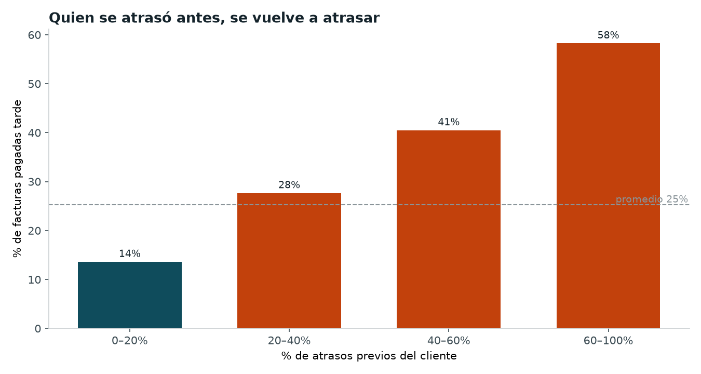
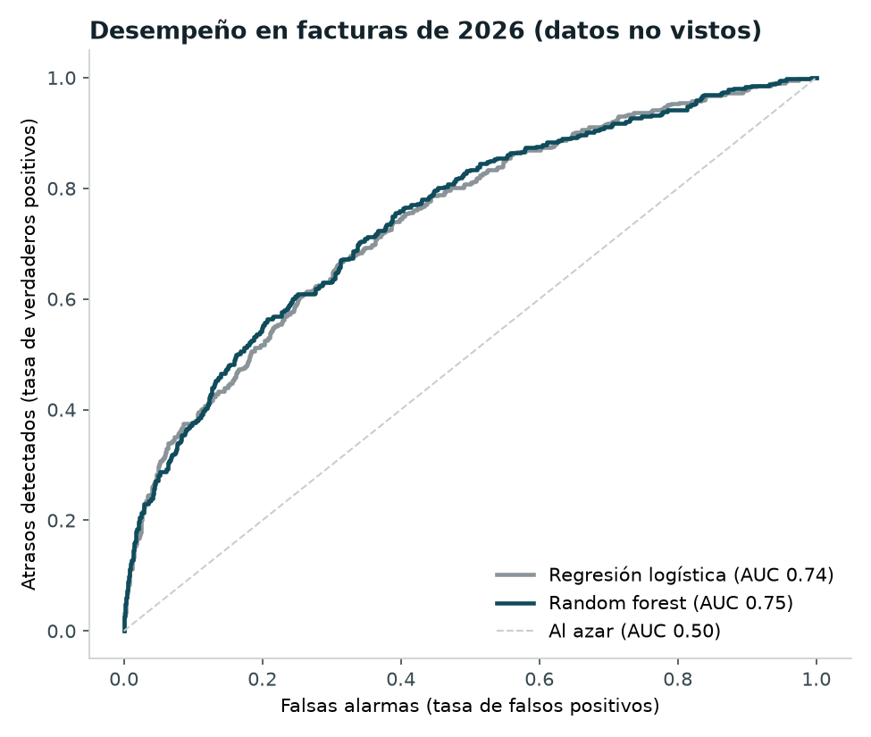

# Late Invoice Payment Prediction (Python + Machine Learning)

Predicts which open invoices are likely to be **paid late**, so a collections team can act before the due date instead of after.

Built by an accounting student and data analyst: the features come from how credit and collections actually work, not just from the columns available.



## Business question

> *Which of our open invoices should we follow up on first?*

## What it does

1. **Cleans** the invoice history: removes duplicate rows, converts amounts stored as text (`"$1,250,000"`) into numbers and rebuilds missing payment terms from issue and due dates.
2. **Builds features**, including each customer's payment track record (% of past invoices paid late, average days late). These are computed using **only information available on the invoice date**, to avoid data leakage.
3. **Trains and compares two models** (logistic regression and random forest) with a **time-based validation**: trained on 2024–2025 invoices, tested on 2026 invoices the model never saw.
4. **Scores every open invoice** with a probability of late payment and a risk level (High / Medium / Low).
5. **Exports** charts and an Excel report ready for the collections team.

## Results (test set: 2026 invoices)

| Metric | Value |
| --- | --- |
| AUC | 0.75 (random forest) vs 0.74 (logistic regression) |
| Late payments detected (recall) | 61% |
| Open invoices flagged as high risk | 57 of 232 |

**Key findings**
- A customer's **past late payments** are by far the strongest predictor: customers who were late on 60%+ of past invoices pay late again 58% of the time, versus 14% for reliable customers.
- **Construction and restaurants** pay late about 40% of the time, three times more than technology clients (13%).
- Invoices issued in **December and January** carry extra risk.



## Output: `reporte_cartera.xlsx`

| Sheet | Content |
| --- | --- |
| Resumen | Key figures in plain language |
| Gráficas | All charts |
| Facturas en riesgo | Every open invoice ranked by late-payment probability, color-coded by risk, with filters |
| Importancia | Which factors drive the prediction |
| Comparación modelos | Metrics for both models |

## How to run

```bash
pip3 install -r requirements.txt
python3 generar_datos.py          # creates the sample invoice history
python3 prediccion_facturas.py    # trains the models and builds the report
```

## About the data

The invoice data is **synthetic**: generated by `generar_datos.py` to mimic a real accounts-receivable ledger (250 customers, about 7,000 invoices, realistic payment behavior and common data-quality issues). The same pipeline works with a real export from an ERP or accounting system that has issue date, due date, payment date, amount and customer.

## Tech stack

Python · pandas · scikit-learn · matplotlib · openpyxl

## Author

Santiago Ramos — Data analyst (Python, pandas, Excel) and accounting student. Certified in *Accounting Data Analytics with Python* and *Machine Learning for Accounting with Python* (University of Illinois, Coursera).
